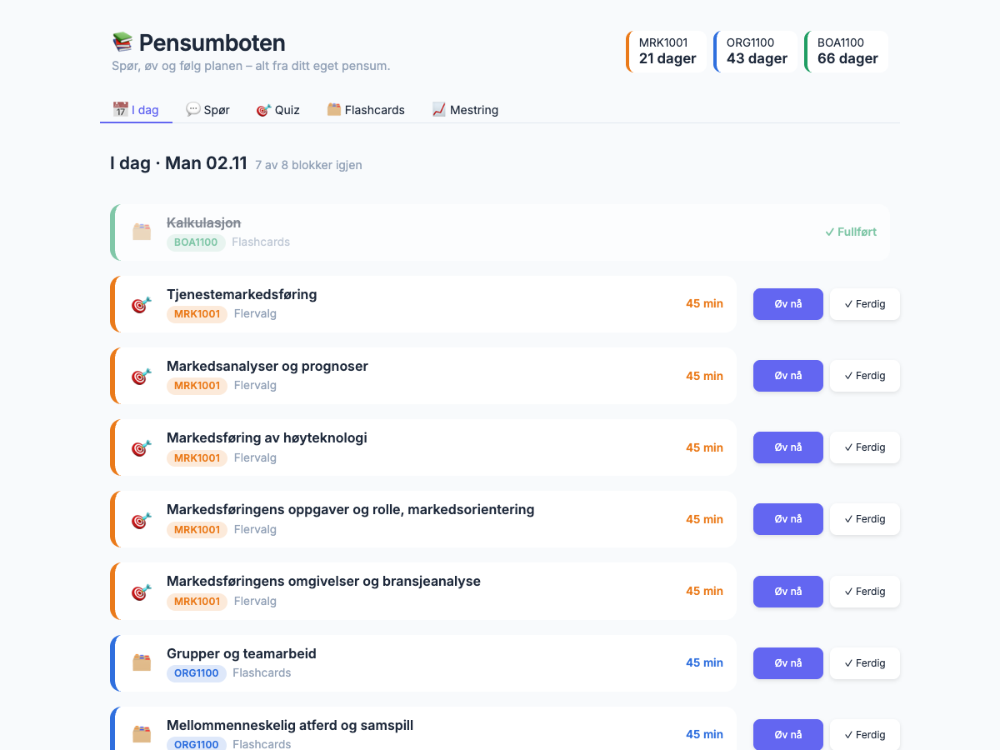
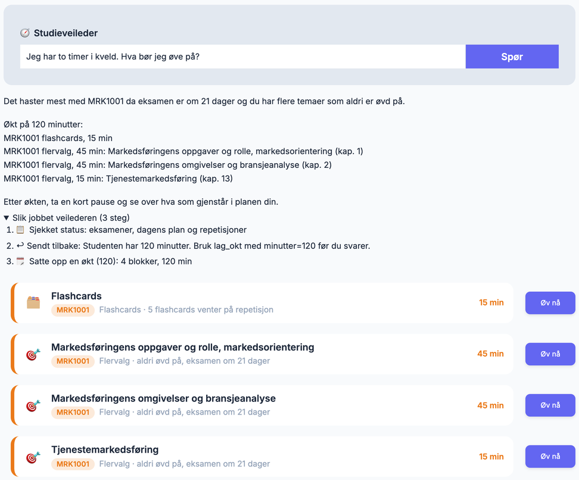
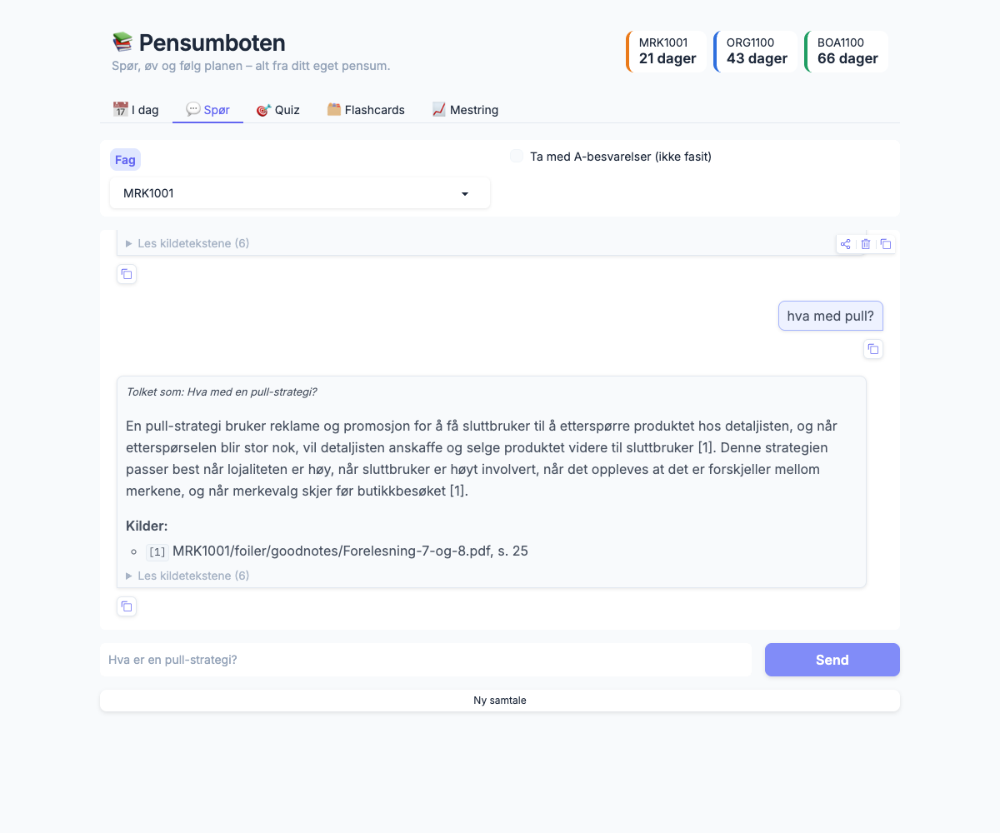
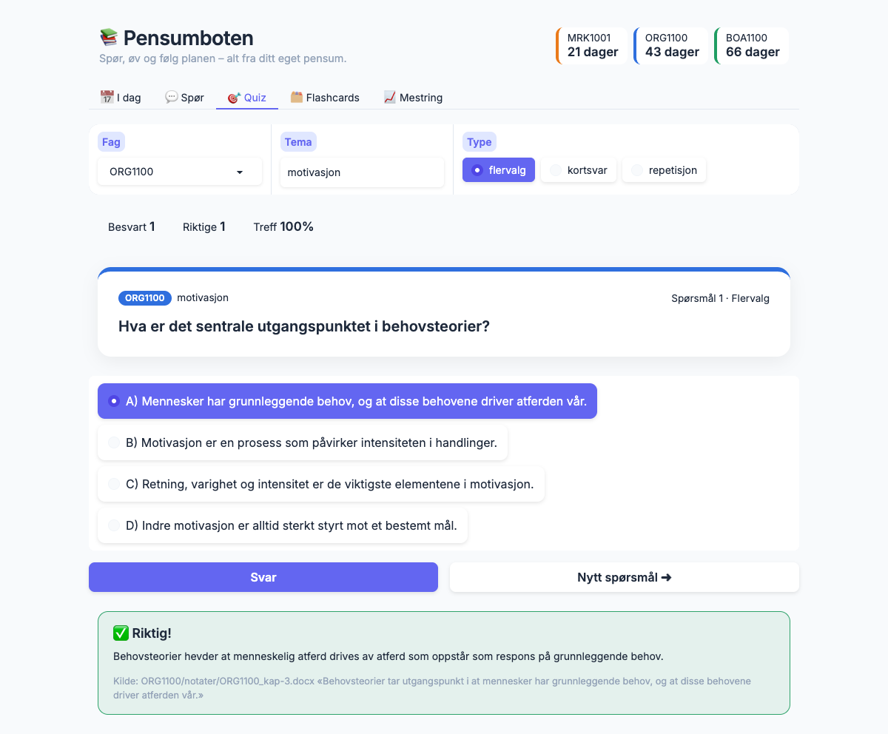
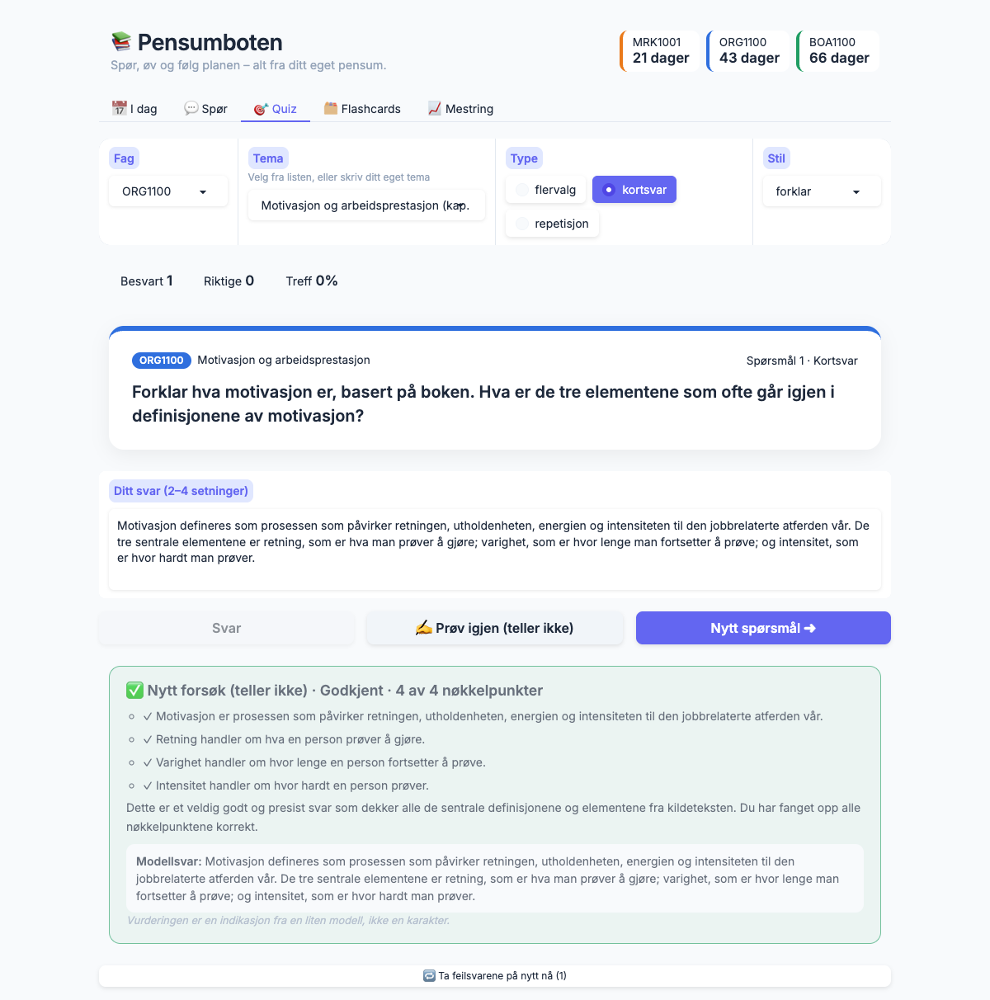
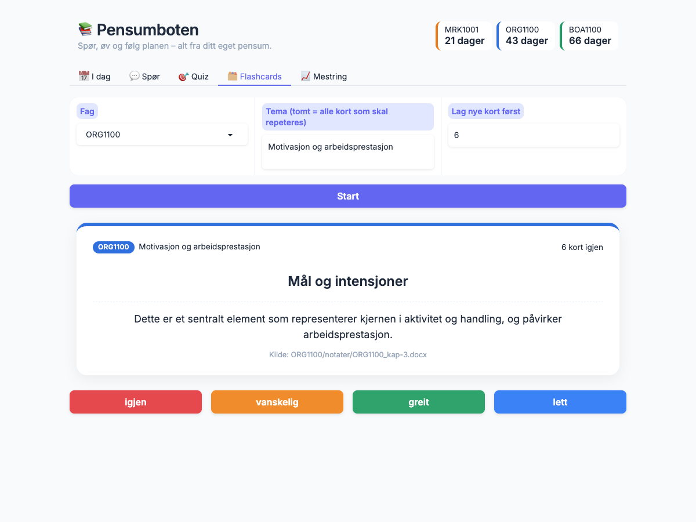
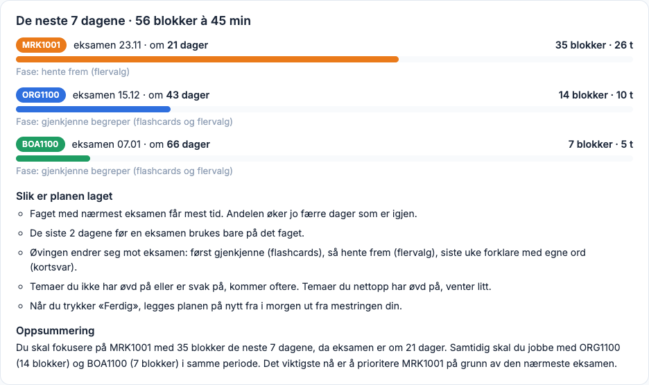
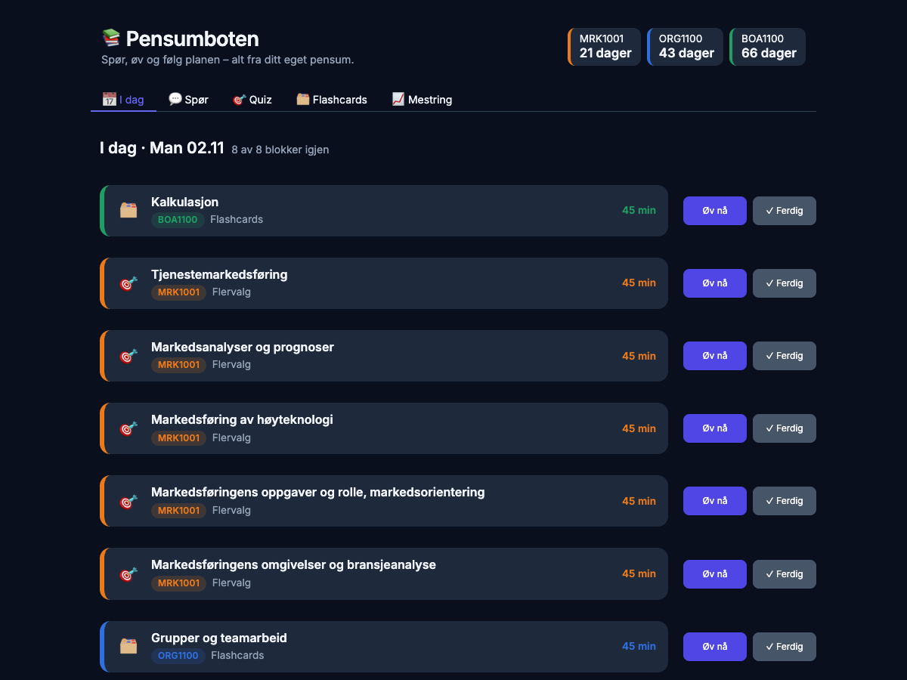

# 📚 Pensumboten

**En personlig AI-studieassistent som kan hele pensumet mitt, og ingenting annet.**

Pensumboten leser foilene, notatene, øvingsoppgavene og de tidligere eksamenene mine. Den svarer på spørsmål med kilde til fil og side, lager quiz og flashcards som kvalitetssjekkes før jeg ser dem, retter kortsvar punkt for punkt, sporer hva jeg mestrer, og legger en leseplan frem til hver eksamen som justerer seg etter hvordan det går. Står svaret ikke i pensum, sier den «Finnes ikke i materialet» i stedet for å finne på noe.

Alt kjører **lokalt på en MacBook**, med en åpen språkmodell via Ollama, så ingen notater forlater maskinen. Søket og promptene er skrevet for hånd, uten ferdige LangChain-kjeder, for at jeg skulle forstå hvert ledd i en RAG-løsning. Kvaliteten er **målt** mot egne testsett.

Jeg er økonomistudent ved NTNU og bygget dette høsten 2026 for å lære RAG og for å øve til eksamenene mine i markedsføring, organisasjon og ledelse og bedriftsøkonomi.

> **English summary:** A fully local AI study assistant built on retrieval-augmented generation. It answers questions with page-level citations from my own course material and refuses when the answer isn't there. It generates multiple-choice and short-answer quizzes that pass four automatic quality checks, grades free-text answers claim by claim, runs spaced repetition for quizzes and flashcards, tracks mastery per topic, and schedules an adaptive exam reading plan. Hand-written retrieval (multilingual embeddings, Chroma, cross-encoder reranking) and prompts, no LangChain chains. Runs on a 16 GB MacBook with Ollama. Measured quality: correct source in the top 6 for 29 of 30 test questions, and 6 of 6 out-of-scope questions correctly refused.



## ✨ Høydepunkter

- 🔎 **Svar med kilde ned på sidenivå**, for eksempel `MRK1001/foiler/Forelesning-7-og-8.pdf, s. 25`, med kildeteksten ett klikk unna
- 🚫 **Sier «Finnes ikke i materialet»** i stedet for å gjette. Testet på felle-spørsmål: 6 av 6
- 🎯 **Quizspørsmål som kontrolleres i fire steg** før du ser dem
- ✍️ **Retting av kortsvar påstand for påstand** mot kildeteksten, med nøkkelpunkter og modellsvar
- 🧠 **Spaced repetition**: feilsvar og flashcards kommer igjen med voksende mellomrom
- 📈 **Mestring per tema** som oppdateres etter hvert svar og styrer planen
- 📅 **Adaptiv eksamensplan** for flere fag samtidig, med nedtelling, prioritering og forklaring
- ⚡ **Neste spørsmål lages i bakgrunnen** mens du svarer, så quizen går nesten momentant
- 🤖 **BØA-agent** som selv velger når den skal søke i pensum og regne, mens koden kontrollerer hvert tall
- 🧮 **BØA-formeltrening**: 32 formler fra pensum, snudd algebraisk, med oppgaver der Python regner fasiten
- 🧩 **Modeller og teorier for MRK og ORG**: 239 modeller hentet fra egne notater, med øving i å kjenne dem igjen, velge riktig modell til en case og analysere casen med den
- 📝 **Eksamensmodus**: en hel case (tidligere eksamen eller en fersk nyhetssak) med oppgaver, én lang besvarelse, og retting mot modellene sensor ser etter
- 🧭 **Studieveileder-agent**: «Jeg har to timer i kveld, hva bør jeg øve på?» gir en ferdig økt med «Øv nå»-knapper
- 🔒 **100 % lokalt og privat**, og ett konfigurasjonsvalg fra å bruke Claude i stedet
- 🧪 **Målt kvalitet** med eget testsett og 279 automatiske tester

## 🧩 Funksjoner

### 💬 Spør pensum
- Chat med historikk, avgrenset til ett fag om gangen
- **Oppfølgingsspørsmål**: «hva med pull?», «forklar det enklere», «gi et eksempel». Boten skriver om spørsmålet ut fra samtalen før den søker, og viser hvordan den tolket deg
- Følger ønsket form: **enklere** språk, **punktliste** eller **eksempel**, men fortsatt bare fra pensum
- Kildeliste fra metadata, og hele kildeteksten kan foldes ut under hvert svar
- A-besvarelser holdes utenfor som standard (de er ikke fasit), men kan slås på

### 🤖 BØA-agenten (bedriftsøkonomi uten kalkulator)
I BØA-chatten svarer en **agent**: språkmodellen bestemmer selv hvilke verktøy den bruker og i hvilken rekkefølge, i en løkke til oppgaven er løst.
- **Verktøy:** `sok_i_pensum` (samme søk og reranker som chatten) og `regn_ut`, en trygg kalkulator som leser uttrykket som et syntakstre og aldri kjører kode
- **Kontroll i koden før svaret vises:** hvert regnestykke i svaret regnes ut på nytt i Python, hvert tall må komme fra oppgaven, pensum eller en utregning, og hver kilde må finnes. Ellers sendes agenten tilbake med beskjed om hva som er feil
- Verktøykall som den lille modellen skriver som tekst i stedet for å kalle, fanges opp og kjøres likevel
- «Slik jobbet agenten» viser hvert steg: søk, utregninger og kontroller
- Virker med både Ollama og Claude (verktøybruk via `chat_med_verktoy` i `src/llm.py`)

Ærlig status med den lille lokale modellen: 4 av 5 testoppgaver riktige. Den femte (nåverdi) regnet modellen feil, og kontrollen merket svaret i stedet for å vise et feil tall som sikkert. Koden kan sjekke regning, men ikke om metoden er riktig, så agenten er laget for å bli mye sterkere med Claude.

### 🧮 BØA-formler
BØA-eksamen er uten hjelpemidler, så formlene må sitte. Fanen har 32 formler fra pensum, hver med kilde, fordelt på kostnader, nullpunkt, kalkulasjon, beslutninger, markedstilpasning, investering og regnskap.
- **Formelark** med hver formel snudd for alle størrelsene, for eksempel NPO = FK/DG, FK = DG · NPO og DG = FK/NPO. SymPy gjør omformingene algebraisk
- **Trening** med fem typer oppgaver: hvilken formel, snu formelen, regn ut, hva skjer hvis («VEK øker, hva skjer med nullpunktet?») og sammenhenger på tvers (pris og VEK → DB → DG → NPO)
- **Fasiten regnes ut i Python**, aldri av språkmodellen, og tallene går opp uten kalkulator, som på eksamen
- Hver løsning viser formelen, utregningen steg for steg og hvor i pensum formelen står. Resultatene teller med i mestringen per tema

### 📝 Eksamensmodus (MRK og ORG)
Fanen «Eksamen» gir deg en hel case med oppgaver. Du skriver én besvarelse og får den rettet punkt for punkt.

- **Tidligere eksamen**: de ekte eksamenscasene fra pensum. Fasiten er modellene sensorveiledningen, løsningsforslaget eller A-besvarelsen brukte, med grunnen til hver
- **Fersk nyhetssak**: `src/nyheter.py` henter overskrifter fra E24, Kampanje, Finansavisen og NRK (RSS) og sorterer dem etter hvor godt de passer faget. Språkmodellen velger så den saken som egner seg best som case (én navngitt virksomhet i en situasjon som kan analyseres), og hopper over saker du har fått før og saker bak betalingsmur. Saken blir casen, med tre oppgaver formulert som på eksamen. Fasiten er modellene oppgaveordene peker på i signalkatalogen
- **Rettingen gjøres i Python**, så den er lik hver gang: hvilke modeller fra fasiten du brukte, modeller sensor sier ikke passer, og en sjekkliste (koblet til casen, 4 P, drøfting, anbefaling, lengde). Språkmodellen skriver bare en kort kommentar til slutt
- Rettingen ser etter om modellene er brukt, ikke hvor godt. Den er en indikasjon, ikke en karakter
- **Dekningsoversikt** i Mestring-fanen: eksamensmodellene i faget, de vanligste først, med hva du har øvd på: kjenn, case og funnet i en hel case. Modeller du ikke har brukt riktig på en case, er merket
- **Modelløving i planen**: de siste tre ukene før eksamen er annenhver blokk i MRK og ORG modelløving

### 🧩 Modeller og teorier (MRK og ORG)
På MRK- og ORG-eksamen skal du bruke modeller og teorier på en case. Fanen «Modeller» viser et modellark med 124 modeller i markedsføring og 115 i organisasjon og ledelse. Hver modell har elementene sine og sidetall eller figur. Alt er hentet fra modellnotatene dine. `config/modeller.yaml` sier hvilke seksjoner som er modeller.
- **Kjenn modellen**: kryss av for alle elementene i en modell, hvilken modell består av disse elementene, hvilket element hører til, hvilket mangler, og hva betyr et element. Spørsmålene lages i Python fra modellarket, uten språkmodell, og de gale svarene er sjekket mot modellen så det bare finnes én riktig fasit
- **Velg modell til casen**: språkmodellen skriver en kort case der én modell passer, og du velger hvilken. Koden stopper caser som røper navnet, forfatteren eller elementene
- **Bruk modellen på casen**: du viser hvordan hvert element kommer til uttrykk i casen. Koden sjekker at du har brukt hvert element ved navn, og språkmodellen sier fra hvis du bruker et element i strid med modellen
- **Finn modellene (MRK og ORG)**: du får en hel eksamenscase med oppgavene og krysser av for modellene du ville brukt. Fasiten kommer fra løsningsforslag, sensorveiledninger og studass-løsninger: Apiir, Comfyballs, Grandiosa, Kari Traa og Spike i MRK, pluss Los Tacos og Hiking Patrol med fasit fra besvarelser, Schjødt (eksamen 2024, fasit fra sensorveiledningen og to A-besvarelser), Elkjøp, Easee og Umoe i ORG. Rettingen viser signalene i casen og modellene de peker på, og modeller sensor sier ikke passer, som Ansoff i Kari Traa. Godkjent når du finner minst halvparten (høyst seks) uten å velge noen som ikke passer
- **Finn signalet**: ett signal om gangen, som «markedsandel på 75 % innen 3 år» eller «frykt og penger», og du krysser av for modellene det peker på
- **Ny case (generert)**: en ny, oppdiktet case hver gang. Python velger først 2–3 signaler fra katalogen som peker på ulike modeller. Språkmodellen skriver én setning per signal og så bakgrunnen rundt dem. Fasiten er modellene til signalene, ikke det språkmodellen mener. Casen forkastes hvis den nevner modellnavnene eller mangler en av signalsetningene. Rettingen viser hvilken setning som var signalet, og det samme signalet i den ekte eksamenen
- **Signalark**: i fanen «Modeller» velger du «Signalark» for å lese alle signalene: ordene å se etter, et sitat fra en ekte eksamenscase, modellene de peker på, hvorfor, og hva sensor ser etter i alle oppgaver. Nederst står et oppslag per modell. Signalene ligger i `config/signaler_MRK1001.yaml` og `config/signaler_ORG1100.yaml`, og en test sjekker at hvert sitat står ordrett i casen. Signaler uten sensorkilde er merket «utledet fra notatene»
- Ligger som typen «modeller og teorier» i quiz-fanen, med repetisjon av feilsvar og mestring per kapittel

### 🧭 Studieveilederen
Øverst i «I dag» kan du spørre med vanlige ord, for eksempel «Jeg har 45 min til BØA, hva gjør jeg?». En agent ser på dine egne data og setter opp en økt.
- **Verktøy:** `se_status` (eksamener, dagens plan, feilsvar og kort som venter), `se_mestring` (per tema, svakest først) og `lag_okt`. Python velger temaene ut fra eksamensdato og mestring og regner minuttene, så økten aldri blir lengre enn tiden du har
- **Kontroll i koden:** oppgir du tid eller fag og agenten ikke bruker det, sendes den tilbake med riktige verdier. Tall og fagkoder i svaret må komme fra dataene
- Hver blokk i økten har en **«Øv nå»-knapp** som åpner quiz eller flashcards med riktig fag og tema
- Veilederen bare leser. Den endrer aldri planen eller databasen
- Kjør også i terminalen: `uv run python -m src.veileder "Hva bør jeg øve på i kveld? Jeg har to timer."`



<p>
  
  
</p>

### 🎯 Quiz
- **Flervalg** og **kortsvar** fra et tema du velger i en rullemeny, eller skriver selv
- Fem stiler for kortsvar: *forklar*, *hvorfor*, *sammenlign*, *case* og *blandet*
- **Fire kvalitetskontroller** på hvert flervalgsspørsmål:
  1. Begrunnelsen må være et **ordrett sitat** fra kilden (minst fem ord)
  2. Riktig svar kan ikke være **mye lengre** enn de gale, så du ikke kan gjette på lengden
  3. **Kontrollrunde:** modellen må svare riktig på sitt eget spørsmål uten å se fasiten
  4. **Duplikatfilter** med embeddings, som stopper spørsmål som likner et du allerede har fått
- Alternativene stokkes av koden, siden språkmodeller ofte legger riktig svar på samme plass
- **Kortsvar rettes påstand for påstand** (stemmer, motsier eller står ikke i kilden), og deretter nøkkelpunkt for nøkkelpunkt
- **«Prøv igjen»** på kortsvar: skriv svaret på nytt etter å ha sett nøkkelpunktene, uten at det teller
- **«Ta feilsvarene på nytt nå»**: en øvingsrunde med feilsvarene fra økten, med alternativene stokket på nytt
- Poengtavle for økten, og en grønn eller rød tilbakemelding med kilde og sitat
- **Forhåndsgenerering:** appen begynner å lage spørsmål så snart temaet er valgt, og holder to klare. Målt fra 6–15 sekunder til 0,1 sekund per spørsmål

<p>
  
  
</p>

### 🗂️ Flashcards
- Kort lages fra pensum per tema, med kilde på baksiden
- Fire vurderinger, **igjen · vanskelig · greit · lett**, som styrer når kortet kommer tilbake
- «Igjen» legger kortet bakerst i samme økt. De andre gir voksende intervaller (×1,2, ×2,5, ×4, maks 180 dager)
- Kortene kontrolleres også med sitat og duplikatfilter

### 📈 Sporing og mestring
Alt lagres i en lokal SQLite-database:
- **Hvert spørsmål** med fasit, kilde, sitat, kildetekst og hvilken modell som laget det
- **Hvert forsøk** med svar, riktig eller feil, tilbakemelding og når det skal repeteres
- **Mestring per tema** som et glidende snitt av forsøkene, der nyere svar teller mest
- **Repetisjon av feilsvar** etter 1, 3, 7, 14 og 30 dager. Deretter regnes spørsmålet som lært
- Mestring-fanen viser snitt per fag, en fremdriftsstolpe per tema, antall forsøk og når du sist øvde
- **Automatisk sikkerhetskopi** hver dag, der de 14 siste dagene beholdes

### 📅 Eksamensplanlegger
- Plan for **alle fagene samtidig** frem til hver eksamen, i blokker på 45 minutter innenfor timene du har per dag
- **Faget med nærmest eksamen får mest tid**, og de siste dagene før en eksamen brukes bare på det faget
- **Øvingsmåten endrer seg mot eksamen**: gjenkjenne (flashcards) → hente frem (flervalg) → forklare med egne ord (kortsvar) → blandet repetisjon
- **Svake og lite øvde temaer kommer oftere.** Temaer du nettopp har øvd på, venter litt
- Planen **legges på nytt** etter hver fullførte blokk, ut fra mestringen din
- «Øv nå» åpner riktig quiz eller kortstokk med fag og tema ferdig utfylt
- «Hopp over i dag» fordeler dagen på resten av planen, og **«Angre»** gir den tilbake
- **«Forklar planen»** viser fordelingen per fag og reglene bak. Tallene regnes i Python, og språkmodellen skriver bare oppsummeringen
- Ukeoversikt for de neste 7 dagene, og **nedtelling** til hver eksamen øverst i appen

<p>
  
  
</p>

### 📄 Innlesing av pensum
- **PDF** (foiler, skannede eksamener), **Word** (overskrifter, lister og tabeller beholdes) og **Markdown**
- **OCR av skannede sider** med Apple Vision på norsk og engelsk, mellomlagret så hver side bare leses én gang
- Metadata på hver bit: fag, type (foiler, notater, oppgaver, eksamener), fil, side og foiltittel
- Fjerner støy som gjentatte bunntekster, og varsler om filer og sider uten tekst

### 🖥️ Grensesnitt
- Nettapp i **Gradio** med eget design: en farge per fag, kort, merker og fremdriftsstolper
- **Lys og mørk modus**, og tilpasset mobilskjerm
- Alt kan også brukes fra **terminalen**, der Ctrl+D avslutter pent
- **Ett ord for å starte**: `start.sh` starter Ollama ved behov og åpner bare nettleseren hvis appen allerede kjører

## ⚙️ Slik virker den

```
pensum/ (PDF, Word, Markdown)
   │  innlesing: tekst per side · OCR av skannede sider (Apple Vision) · metadata
   ▼
biter på ~1000 tegn med overlapp ──► embeddings (multilingual-e5-base) ──► Chroma (lokalt)
                                                                              │
spørsmål ──► omskriving av oppfølgingsspørsmål ──► vektorsøk, 30 kandidater ──┘
                                                       │  filter: fag, type, uten eksempelsvar
                                                       ▼
                                   reranker (bge-reranker-v2-m3) → 6 beste biter
                                                       │
                             prompt med nummererte biter → språkmodell (Ollama / Claude)
                                                       │
                              svar med [1][2] → kildeliste fra metadata (fil, side)
```

Valg som ga en målbar forskjell:

- **Kildene settes av koden, ikke av modellen.** Modellen viser bare til bitnumre, så den kan ikke finne på sidetall.
- **Reranking** med en cross-encoder etter vektorsøket løftet riktig kilde inn blant de 6 beste.
- **Kontekst foran PDF-bitene** (fag · fil · foiltittel) brukes bare i søkevektoren. MRR for markedsføring gikk fra 0,813 til 0,872.
- **Strukturerte JSON-svar** fra modellen for quiz og retting, med bevisst løse skjemaer. Strenge skjemaer gjorde den lokale modellen 100 ganger tregere.
- **Tall regnes ut i Python, aldri av språkmodellen**: plan, prioritering, intervaller og mestring.
- **Valgt for 16 GB minne:** en kvantisert modell og en reranker i halv presisjon, etter at det første oppsettet fikk Macen til å bruke swap.

## 📊 Resultater

Målt mot håndlagde testsett (`tester/testsett_*.yaml`) med `uv run python -m src.testsett --med-svar`:

| Fag | Riktig kilde blant 6 | MRR@20 | Felle-spørsmål avvist | Falske «finnes ikke» |
|---|---|---|---|---|
| Organisasjon og ledelse | 14 av 15 | 0,882 | 3 av 3 | 0 |
| Markedsføring | 15 av 15 | 0,967 | 3 av 3 | 0 |

Felle-spørsmålene spør om ting som *ikke* står i pensum, for eksempel Blue Ocean, NPS og Hofstede. Riktig svar er da «Finnes ikke i materialet». I tillegg finnes **279 enhetstester** for planleggeren, repetisjonen, mestringen, angre-knappen, sikkerhetskopien, agentenes kalkulator og kontroller, hvordan veilederen setter opp økter, at hver BØA-formel, omforming og fasit regner riktig, og at modellspørsmålene har én entydig fasit (blant annet at kalkulatoren aldri kjører kode). Hver endring testes også i nettleseren før den committes.

## 🛠️ Teknologi

| Verktøy | Brukes til |
|---|---|
| **Python 3.13** + **uv** | Språk, virtuelt miljø og låste avhengigheter |
| **Ollama** · `gemma4:e4b-it-qat` | Lokal språkmodell for svar, quiz, flashcards og retting |
| **Anthropic SDK** (Claude) | Alternativ leverandør, valgt med én linje i konfigurasjonen |
| **sentence-transformers** · `intfloat/multilingual-e5-base` | Flerspråklige embeddings for norsk tekst, og duplikatfilteret |
| **sentence-transformers** · `BAAI/bge-reranker-v2-m3` | Cross-encoder som rangerer søketreffene på nytt |
| **Chroma** | Lokal vektordatabase med cosinusavstand og metadatafiltre |
| **LangChain** (`PyPDFLoader`, `RecursiveCharacterTextSplitter`) | PDF-lesing og oppdeling i biter. Søk og prompt er skrevet for hånd |
| **pypdf** · **PyMuPDF** | Tekst fra PDF, og sider gjort om til bilder for OCR |
| **ocrmac** (Apple Vision) | OCR av skannede sider på norsk og engelsk |
| **python-docx** | Word-notater med overskrifter, lister og tabeller |
| **SQLite** | Spørsmål, forsøk, mestring, plan og daglige sikkerhetskopier |
| **Gradio** + egen CSS | Nettappen, med farger per fag og lys og mørk modus |
| **SymPy** | Snur BØA-formlene algebraisk og sjekker at gale svaralternativer virkelig er gale |
| **PyYAML** · **python-dotenv** | Innstillinger, eksamensdatoer og API-nøkkel |
| **pytest** | Enhetstester |

Rundt 6 500 linjer Python fordelt på 27 filer. Hver del (innlesing, indeks, henting, svar, quiz, flashcards, repetisjon, planlegger, app) kan kjøres og testes for seg.

## 🚀 Kom i gang

Krever macOS (OCR bruker Apple Vision), [uv](https://docs.astral.sh/uv/) og [Ollama](https://ollama.com).

```bash
git clone https://github.com/arnulfflo/pensumbot.git && cd pensumbot
uv sync
uv run python -m src.sjekk_maskin        # foreslår modell ut fra minnet på maskinen
ollama pull gemma4:e4b-it-qat

# Legg egne filer i pensum/<FAG>/{foiler,notater,oppgaver,eksamener}/
# og fag, eksamensdatoer og temaer i config/innstillinger.yaml og config/eksamener.yaml
uv run python -m src.indeks              # les inn og bygg søkeindeksen
./start.sh                               # åpner appen på http://127.0.0.1:7860
```

Fra terminalen: `src.chat`, `src.quiz`, `src.flashcards`, `src.i_dag`, `src.planlegger`, `src.repetisjon` og `src.testsett` (se `--help` på hver).

## 🔒 Personvern og opphavsrett

Alt kjører lokalt. Ingen tekst sendes ut av maskinen så lenge Ollama brukes, og appen lytter bare på `127.0.0.1`. Det eneste som går ut på nettet, er nyhetsverktøyet i eksamensmodus: det henter RSS-filer og artikkelen du velger, og sender ingenting om deg eller pensumet. Pensum, notater, eksamener og andres besvarelser ligger i `pensum/` og er **ikke** med i dette repoet. Det samme gjelder `data/` (søkeindeks og fremgang) og `.env`.

## 🤝 Laget med Claude Code

Jeg bygget prosjektet sammen med [Claude Code](https://claude.com/claude-code) som parprogrammerer, ett steg om gangen og med testing mellom hvert. Commitene viser det. Målet var å forstå hva som skjer i hvert ledd, ikke bare å få noe som virker: hvorfor e5 trenger `query:`- og `passage:`-prefiks, hvorfor en reranker hjelper, og hvordan man måler at en endring faktisk ble bedre.

## Lisens

[MIT](LICENSE)
